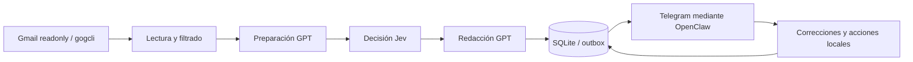

# 🤖 Mail Assistant

[English](README.md) | **Español**

[](#estado-y-alcance)
[](LICENSE)
[](VERSION)
[](https://github.com/jmdurgali03/mail-assistant/actions/workflows/tests.yml)
[](https://github.com/jmdurgali03/mail-assistant/issues)
[](https://github.com/jmdurgali03/mail-assistant/commits/main/)

## Descripción General del Proyecto

Asistente de correo con núcleo local en Python y SQLite, adaptadores de lectura de Gmail y notificaciones privadas por Telegram mediante OpenClaw. Prepara evidencia del correo, clasifica su prioridad y redacta un resumen breve, manteniendo separados el análisis, las propuestas de acciones y su ejecución.

El núcleo y la demo pueden ejecutarse **sin cuentas, credenciales ni servicios externos**. Las integraciones reales son avanzadas y requieren configuración propia.

## 🚀 Características Principales

- **Planificación local**: seguimiento de pendientes, prioridades, propuestas de etiquetas y digest.
- **Análisis por etapas**: preparación GPT → decisión Jev → redacción GPT, con evidencia y validación de contratos.
- **Gmail en modo lectura**: comprobación de cuenta y permisos; sin envío, archivado ni modificación automática de Gmail.
- **Notificaciones privadas**: bandeja de salida SQLite, deduplicación y bloqueo ante entregas inciertas, sin reenvío automático.
- **Protección de contenido sensible**: tratamiento conservador de códigos de acceso y autenticación; no constituye un detector infalible.
- **Acciones locales**: botones de revisado y posposición; las correcciones no modifican Gmail. Incluye agrupación específica de avisos de IOL.
- **Pruebas sintéticas**: contratos, aislamiento de identidad, recuperación y procesos con ejecutables falsos.

## 🛠️ Tecnologías Utilizadas

| Componente | Tecnología |
|---|---|
| Núcleo | Python 3.12+, biblioteca estándar |
| Persistencia | SQLite (`sqlite3`) |
| Puentes y plugins | JavaScript ESM, Node.js 24.16+ |
| Integraciones opcionales | OpenClaw, gogcli, Google OAuth, Telegram, TypeSafe/Jev |
| Programación opcional | systemd de usuario en Linux |

No hay dependencias pip ni npm de terceros para la demo o las pruebas. Los módulos `fcntl` y `resource` requieren un entorno Unix; **Linux es la plataforma de referencia**. La integración real puede implicar costos de proveedores y no se activa al instalar el proyecto.

## 🏗️ Arquitectura del Proyecto



- `src/assistant.py`: estado local, ingestión y propuestas; no realiza operaciones externas.
- `src/pipeline.py`: adaptadores y outbox transaccional.
- `src/mail_stages.py`, `src/jev_decisions.py`, `src/jev_gateway.mjs`: preparación, clasificación y redacción.
- `src/mail_watch.py`: captura de nuevos correos desde una frontera de activación explícita.
- `src/gmail_consent.py`, `src/gmail_unlock.py`, `src/mail_reconnect.py`: consentimiento y recuperación de credenciales.
- `plugins/telegram-plugin/`, `plugins/actions-plugin/`: integración con el runtime existente; no crean otro consumidor de Telegram.
- `tests/test_*.py` y `*/test_plugin.mjs`: pruebas sintéticas.

La estructura del código está descrita en el [README en inglés](README.md#-architecture-and-repository-layout). Para instalaciones existentes, consultá la [guía de migración](docs/migration.md).

## ⚙️ Instalación

### 1. Clonar el repositorio

```bash
git clone https://github.com/jmdurgali03/mail-assistant.git
cd mail-assistant
```

### 2. Comprobar requisitos

```bash
python3 --version
node --version
```

No hace falta ejecutar `npm install` ni `pip install` para probar el núcleo. La base de zonas horarias del sistema debe incluir `America/Argentina/Salta`, actualmente utilizada en los horarios del asistente.

### 3. Configuración y Variables de Entorno (.env)

**El proyecto no carga archivos `.env` automáticamente.** La configuración de la aplicación es JSON; las variables se exportan al proceso o las suministra systemd. No hace falta ninguna para la demo.

Para explorar la configuración del núcleo:

```bash
cp examples/config.example.json config.local.json
chmod 600 config.local.json
```

Reemplazá los placeholders únicamente en tu copia privada. Los flags de lectura, análisis, entrega y programación están desactivados por defecto. El archivo de ejemplo del núcleo **no es una configuración lista para el worker continuo**.

| Variable | Uso |
|---|---|
| `HOME` | Ubicación de perfiles y estado privado del operador |
| `CREDENTIALS_DIRECTORY` | Directorio entregado por systemd con `gmail-keyring-password` |
| `PORT`, `PUBLIC_URL` | Puerto y origen del portal OAuth cuando se ejecuta explícitamente |
| `GOG_KEYRING_PASSWORD` | Solo el adaptador la transmite al subproceso gog; no guardarla en `.env` ni en Git |

Las credenciales OAuth, contraseñas del almacén, tokens y bases de datos reales deben permanecer **fuera del repositorio**. Ver [seguridad](SECURITY.md) y [límites de las integraciones](docs/integrations.md).

### 4. Iniciar la demo

```bash
python3 src/demo.py
```

La demo utiliza fixtures y una base temporal; muestra una notificación preparada y contadores de cero lecturas, escrituras y envíos externos. No contacta Gmail ni Telegram.

## 🚀 Uso

### Ejecutar las pruebas

```bash
bash scripts/check.sh
```

El script usa un `HOME` temporal y un entorno reducido, ejecuta las pruebas Python y de ambos plugins, y luego la demo. No requiere una instalación de OpenClaw ni credenciales. No es un sandbox de red o filesystem.

### Consultar el núcleo local

```bash
python3 src/assistant.py --help
python3 src/pipeline.py --help
python3 src/mail_watch.py --help
```

Para operar con datos reales, revisá primero [la guía de integración](docs/integrations.md). Los ejemplos no inician servicios ni activan temporizadores.

### Estado y alcance

**Versión experimental 0.1.0.** Se publica el código de la aplicación y sus pruebas, no la configuración ni el historial operativo de una instalación personal.

Los adaptadores conservan contratos estrictos de modelos, configuración y binarios. **No es una instalación turnkey ni se garantiza compatibilidad con cualquier versión de OpenClaw.** Las pruebas sintéticas no demuestran una conexión real con Gmail, modelos o Telegram. Se excluyeron parches locales y pruebas históricas del loader interno de OpenClaw que no pertenecen a la aplicación.

## 🤝 Contribución

1. Hacé un fork del repositorio.
2. Creá una rama: `git switch -c feature/nueva-funcionalidad`.
3. Implementá el cambio con pruebas pertinentes y ejecutá `bash scripts/check.sh`.
4. Abrí un pull request explicando el problema, la solución y cómo lo verificaste.

No incluyas correos reales, credenciales ni dumps de bases de datos. Consultá [CONTRIBUTING.md](CONTRIBUTING.md). Se agradecen mejoras de portabilidad, instalación, documentación y compatibilidad del runtime.

## 📄 Licencia

Este proyecto está bajo la [Licencia MIT](LICENSE). Las herramientas y servicios externos mantienen sus propias licencias y condiciones.
