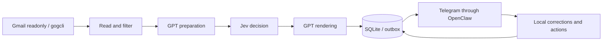

# 🤖 Mail Assistant

**English** | [Español](README.es.md)

[](#status-and-scope)
[](LICENSE)
[](VERSION)
[](https://github.com/jmdurgali03/mail-assistant/actions/workflows/tests.yml)
[](https://github.com/jmdurgali03/mail-assistant/issues)
[](https://github.com/jmdurgali03/mail-assistant/commits/main/)

## Project Overview

A local-first email assistant built with Python and SQLite, with read-only Gmail adapters and private Telegram notifications through OpenClaw. It gathers email evidence, classifies priority and drafts concise summaries, keeping analysis, proposed actions and execution separate.

The core and demo run **without accounts, credentials or external services**. Live integrations require operator-specific configuration.

## 🚀 Key Features

- **Local planning:** track pending items, priorities, proposed labels and digests.
- **Staged analysis:** GPT preparation → Jev decision → GPT rendering, with evidence and contract validation.
- **Read-only Gmail:** account and permission checks; no automatic sending, archiving or Gmail modifications.
- **Private notifications:** SQLite outbox, deduplication and fail-closed handling of uncertain delivery, without automatic retries.
- **Sensitive-content protection:** conservative handling of authentication and access codes; detection is not infallible.
- **Local actions:** reviewed and snooze buttons, local corrections and specialized grouping for IOL financial notifications.
- **Synthetic checks:** contracts, identity isolation, recovery and subprocess tests using fake executables.

## 🛠️ Technology Stack

| Component | Technology |
|---|---|
| Core | Python 3.12+, standard library |
| Storage | SQLite (`sqlite3`) |
| Bridges and plugins | JavaScript ESM, Node.js 24.16+ |
| Optional integrations | OpenClaw, gogcli, Google OAuth, Telegram, TypeSafe/Jev |
| Optional scheduling | Linux user systemd |

No third-party pip or npm packages are needed for the demo or tests. Unix-only modules (`fcntl`, `resource`) make **Linux the reference platform**. Live integrations may incur provider charges and are not enabled by installation.

## 🏗️ Architecture and Repository Layout



```text
src/                  Python application modules and Jev gateway
tests/               Synthetic Python tests and fixtures
plugins/
  actions-plugin/     Telegram notification actions
  telegram-plugin/    Local analysis corrections
examples/             Sanitized JSON configuration templates
scripts/check.sh      Reproducible synthetic checks
systemd/              Optional user service and timer templates
docs/                 Integration and migration guides
```

All Python modules remain together in `src/` to preserve their sibling imports and subprocess entry points. Tests are separate from production code.

- `src/assistant.py`: local state, ingestion and proposals; no external operations.
- `src/pipeline.py`: adapters and transactional outbox.
- `src/mail_stages.py`, `src/jev_decisions.py`, `src/jev_gateway.mjs`: preparation, classification and rendering.
- `src/mail_watch.py`: new-email capture from an explicit activation boundary.
- `src/gmail_consent.py`, `src/gmail_unlock.py`, `src/mail_reconnect.py`: consent and credential recovery.
- Plugins use the existing runtime; they do not create another Telegram consumer.

## ⚙️ Installation

### 1. Clone the repository

```bash
git clone https://github.com/jmdurgali03/mail-assistant.git
cd mail-assistant
```

### 2. Check requirements

```bash
python3 --version
node --version
```

There is no `npm install` or `pip install` step for the core. The system timezone database must include `America/Argentina/Salta`, currently used for assistant scheduling.

### 3. Configuration and Environment Variables (.env)

**The application does not automatically load `.env` files.** Application configuration uses JSON. Export environment variables to the process or supply them through systemd. The demo needs none.

```bash
cp examples/config.example.json config.local.json
chmod 600 config.local.json
```

Replace placeholders only in your private copy. Reading, analysis, delivery and scheduling flags are disabled by default. The core example is **not a ready-to-run continuous-worker configuration**.

| Variable | Purpose |
|---|---|
| `HOME` | Operator profiles and private state |
| `CREDENTIALS_DIRECTORY` | systemd credential directory containing `gmail-keyring-password` |
| `PORT`, `PUBLIC_URL` | OAuth portal port and origin when explicitly launched |
| `GOG_KEYRING_PASSWORD` | Passed to the gog subprocess by the adapter only; never store in `.env` or Git |

Keep OAuth credentials, keyring passwords, tokens and real databases **outside the repository**. See [security](SECURITY.md) and [integration limits](docs/integrations.md).

### 4. Run the demo

```bash
python3 src/demo.py
```

The demo uses fixtures and a temporary database. It displays a prepared notification and counters showing zero external reads, writes and sends. It does not contact Gmail or Telegram.

## 🚀 Usage

### Run checks

```bash
bash scripts/check.sh
```

The script uses a temporary `HOME` and reduced environment, runs Python and plugin tests, then the demo. It requires neither OpenClaw nor credentials. It is not a filesystem or network sandbox.

### Explore the local CLI

```bash
python3 src/assistant.py --help
python3 src/pipeline.py --help
python3 src/mail_watch.py --help
```

Read the [integration guide](docs/integrations.md) before using real data. Examples do not start services or enable timers. Existing checkouts should follow the [layout migration guide](docs/migration.md).

### Status and scope

**Experimental version 0.1.0.** This repository contains application code and synthetic tests, not a personal installation's configuration or operational history.

Adapters enforce strict model, configuration and binary contracts. **This is not a turnkey installation, and compatibility with every OpenClaw version is not guaranteed.** Synthetic tests do not prove live Gmail, model or Telegram connectivity. Runtime-specific patches and historical internal-loader tests are not included.

Documentation is available in English and Spanish. Existing runtime messages and serialized values may still be Spanish; this documentation update does not change data contracts or translate stored data.

## 🤝 Contributing

1. Fork the repository.
2. Create a branch: `git switch -c feature/my-change`.
3. Implement a focused change, add relevant tests and run `bash scripts/check.sh`.
4. Open a pull request describing the problem, solution and verification.

Never include real emails, credentials or database dumps. See [CONTRIBUTING.md](CONTRIBUTING.md). Portability, setup, documentation and runtime compatibility improvements are welcome.

## 📄 License

Released under the [MIT License](LICENSE). External tools and services retain their own licenses and terms.

## Provider quota recovery

The watcher keeps affected messages in a persistent SQLite queue when GPT reports
a quota/rate limit or the Jev gateway is unavailable. Gmail capture continues
during the 15-minute analysis cooldown; retries use the existing GPT → Jev → GPT
pipeline, up to three messages per cycle, without switching models.

After a recovery batch finishes, Telegram receives a durable multipart report
alongside the usual individual notifications. Existing promotion/social filters
and authentication-code protection remain in force. Ambiguous deliveries are
never resent automatically; invalid analysis results and interrupted processing
claims still require review. Historical review records are not replayed.

Queue capture requires valid Gmail authorization. A chat token limit does not
necessarily mean the worker's provider quota is exhausted.
